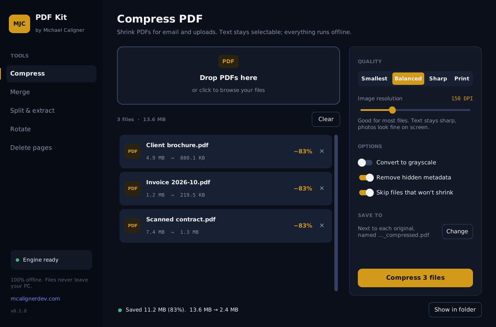

# MJC PDF Kit

A small Windows desktop app for everyday PDF work: **compress, merge, split/extract, rotate, delete pages**. Everything runs on your PC. Files never get uploaded anywhere.

Built by [Michael Caligner](https://mcalignerdev.com). Inspired by [MinimalPDF Compress](https://github.com/deminimis/minimalpdfcompress), written from scratch with a simpler stack.



## What it does

| Tool | What you get |
|---|---|
| **Compress** | Batch-shrink PDFs. Presets (Smallest 72 DPI, Balanced 150, Sharp 220, Print 300) or a custom DPI slider. Grayscale, metadata removal, and "skip files that won't shrink". Shows before → after for each file. Text stays selectable. |
| **Merge** | Combine PDFs in any order (up/down arrows). |
| **Split & extract** | Every page, every N pages, or custom ranges like `1-3, 7, 10-end`. Optionally put the picked pages into one file. |
| **Rotate** | 90° right, 180°, 90° left. All pages or a range. |
| **Delete pages** | Remove pages by range, with a live "12 pages → 9 pages" preview. |

Drag and drop from Explorer works everywhere. The app remembers your last compression settings. Your original files are never overwritten.

## Stack

- **Python 3.12** + **CustomTkinter** (UI) + **tkinterdnd2** (drag and drop)
- **Ghostscript** for compression (the same engine the original uses)
- **pikepdf** for page tools and final cleanup
- **PyInstaller** to make the `.exe`

## Run it (development)

1. Install [Python 3.12](https://www.python.org/downloads/) and tick **Add python.exe to PATH**.
2. Install [Ghostscript for Windows](https://ghostscript.com/releases/gsdnld.html) (64-bit, AGPL release).
3. Double-click **`run.bat`**. The first run sets up a `.venv` and installs dependencies.

## Build the .exe

Double-click **`build.bat`**. When it finishes, `dist\MJC PDF Kit.exe` opens in Explorer. That single file is the app.

### Bundle Ghostscript (optional)

By default the `.exe` uses whatever Ghostscript is installed on the PC (the sidebar shows **Engine ready** or **Ghostscript missing** with a download link). To ship one self-contained `.exe`:

1. Copy `C:\Program Files\gs\gs10.xx.x\bin` and `...\lib` into a `ghostscript` folder in this project, so you have `ghostscript\bin\gswin64c.exe`.
2. Run `build.bat` again. It detects the folder and bundles it.

**License note:** Ghostscript is AGPL-3.0. If you give out an `.exe` with Ghostscript bundled, you need to follow the AGPL for that part (include its license and offer its source). Not bundling it, and asking users to install Ghostscript themselves, avoids that. Not legal advice. Check before you sell or distribute it.

## Tests

```
pip install pytest
python -m pytest -q
```

15 tests cover page-range parsing, merge/split/rotate/delete, and compression (the compression tests need Ghostscript installed).

## Project layout

```
app/
  config.py          name, author, site, version  ← rebrand here
  settings.py        remembers last choices (%APPDATA%\MJC PDF Kit\settings.json)
  core/              no UI code; safe to reuse in a CLI or web backend
    compress.py      Ghostscript + pikepdf pipeline, presets
    ghostscript.py   finds gswin64c.exe (bundled, PATH, Program Files)
    pages.py         merge, split, rotate, delete
    ranges.py        "1-3, 7, 10-end" parser
  ui/
    theme.py         brand colors and fonts (mcalignerdev.com palette)
    widgets.py       buttons, drop zone, status line
    worker.py        runs PDF jobs off the UI thread
    window.py        sidebar + navigation
    views/           one file per tool
assets/              app.ico, icon.png; drop logo.png here to use your MJC mark in the sidebar
okf/                 project knowledge (architecture, decisions, roadmap)
```

## Customize

- **Name / links:** `app/config.py`
- **Colors / fonts:** `app/ui/theme.py`
- **Logo:** save your MJC mark as `assets/logo.png` (square, transparent background). The sidebar picks it up automatically.
- **Icon:** edit and re-run `scripts/make_icon.py`, or replace `assets/app.ico`.
- **Compression presets:** `PRESETS` in `app/core/compress.py`.
